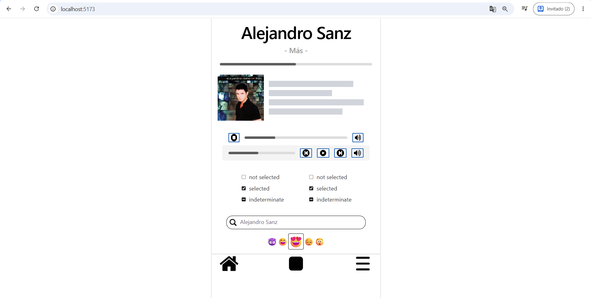
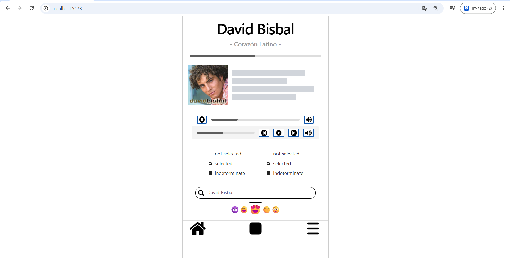

# Conversion de Prototipos a React.JS

Aplicación desarrollada con React que replica el mockup proporcionado, respetando la jerarquía visual, distribución y estilo.

---

## Proceso de creación

1. **División del diseño:** Tras analizar el mockup, se divide en 8 partes independientes (coincidentes con los elementos obligatorios).
2. **Creación de componentes:** Se crea un archivo .jsx para cada componente. Se añade a alguno de ellos propiedades con valores por defecto.
3. **Estilos CSS:** Cada componente tiene su propio archivo css correspondiente con los estilos.
4. **Datos de los cantantes:** La información de Alejandro Sanz y David Bisbal se encuentran en un archivo para poder cambiar fácilmente de artista sin modificar los componentes.


---

## Árbol de componentes

```
App 
├── Cabecera                  
├── BarraProgreso      
├── InfoAlbum              
├── Reproductor  
│   └── BarraProgreso 
├── CasillasSeleccionables 
├── Busqueda 
├── Emoticonos
└── BarraInferior
```

---

##  Cómo cambiar de cantante

Para cambiar de cantante abrimos el archivo `src/App.jsx` y cambiamos el valor de la variable cantante.  
Sustituimos `const cantante = cantantes.alejandro;` por `const cantante = cantantes.bisbal;`  
Guardamos los cambios y los cambios se actualizarán de manera automática.

---

## Instalación y ejecución

Para clonar y ejecutar este proyecto en tu equipo local, sigue estos pasos:

1. **Clona el repositorio:**
   ```bash
   git clone https://github.com/AnaMagallon/reproductor
   ```
2. **Accede a la carpeta del proyecto:**
   ```bash
   cd reproductor
   ```
3. **Instala las dependencias:**
   ```bash
   npm install
   ```
4. **Arranca el servidor de desarrollo:**
   ```bash
   npm run dev
   ```
5. Abre en tu navegador la dirección local que indique la terminal (habitualmente `http://localhost:5173`).

---

## Captura del resultado


